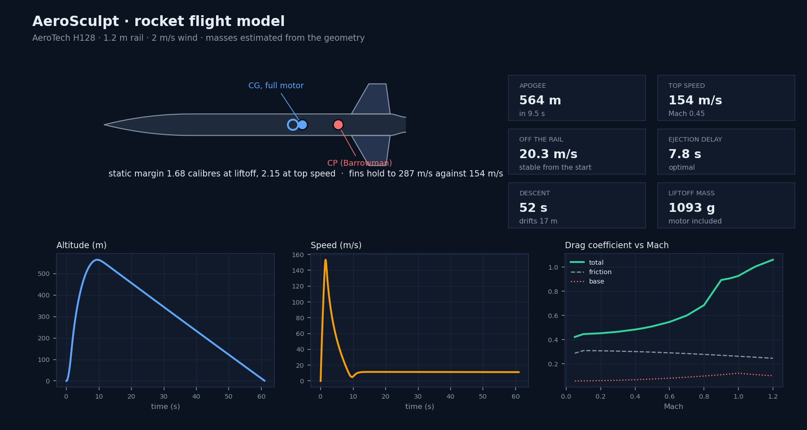
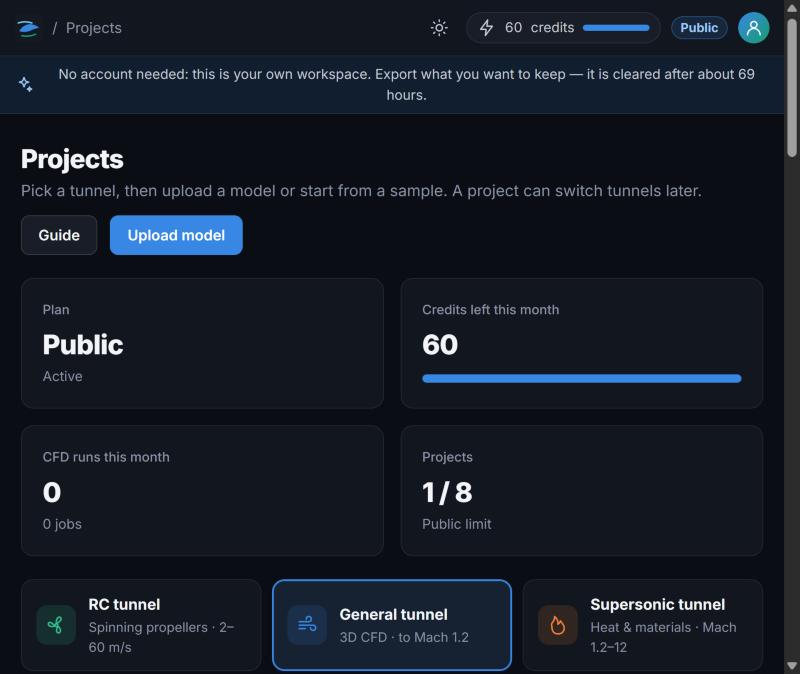
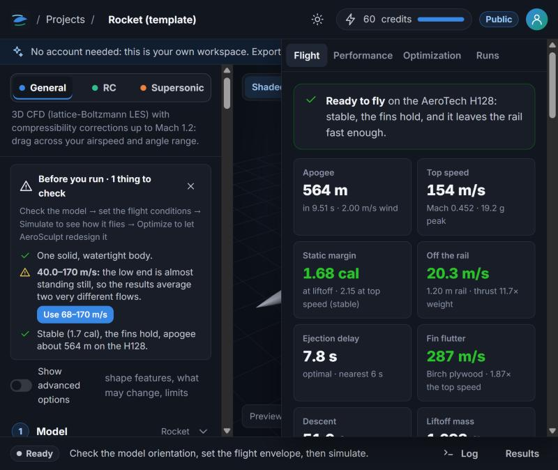

<p align="center">
  
</p>
<h1 align="center">AeroSculpt</h1>
<p align="center"><b>Three wind tunnels, a rocket flight model and a design optimizer, in a browser tab.</b><br>
Drop in a rocket, a drone or a wing. Find out how it flies. Let the optimizer make it fly better.</p>

<p align="center">
  <a href="https://github.com/swishy1104/aerosculpt/releases/latest"></a>
  <a href="https://github.com/swishy1104/aerosculpt/actions/workflows/tests.yml"></a>
  <a href="https://github.com/swishy1104/aerosculpt/actions/workflows/desktop.yml"></a>
</p>

<p align="center"></p>

## What it does

| You bring | AeroSculpt gives back |
|---|---|
| 🚀 An **OpenRocket / RockSim** file, or a rocket built from sliders | Stability (CP and CG drawn on the rocket), apogee, top speed, rail-exit speed, the right ejection delay, fin flutter, descent and drift — **live, as you move a slider** |
| 🛩️ A **drone, wing or UAV** (STL, OBJ, STEP, IGES, 3MF, PLY, glTF) | Drag, lift and L/D across speeds and angles, surface pressure, streamlines, vortices; wings sized at the lift they must carry, with a spar |
| 🔥 Anything that goes **supersonic** | Wave, base and friction drag to Mach 12, wall temperature and heat flux against the material's limit |
| 🎯 A design goal | The optimizer changes the real dimensions (nose, fins, boat-tail, span, section...), keeps only what measurably helps, and refuses to report a win that is inside the solver's own error |

Everything is checked against published data on the **Validation** page, and the app says plainly what it is not sure of.

## Try it in 60 seconds

**In the browser:** open **https://app.aerosculpt.app**, press *Rocket* and move a slider. The Flight tab reacts immediately. Drop your own `.ork` file to see your rocket.

**On your own computer (Windows, no Python):** download `AeroSculpt-<version>-windows.zip` from the
[latest release](https://github.com/swishy1104/aerosculpt/releases/latest), unzip, run `AeroSculpt.exe`.
With an NVIDIA card, unzip the GPU pack from the same page over it first — the CFD runs about 12x faster.
Windows will warn about an unknown publisher the first time (the app is not code-signed yet).

**From source (any OS):**

```bash
git clone https://github.com/swishy1104/aerosculpt
cd aerosculpt
pip install -r requirements.txt
python run.py serve          # then open http://localhost:8000
```

<p align="center">
  
  
</p>

## The three tunnels

| Tunnel | Speeds | Physics |
|---|---|---|
| **RC** | 2–60 m/s | General tunnel + propellers: blade-element momentum theory with two measured blade families and 2–6 blades (checked against UIUC data, thrust/power within 8 %) as actuator disks in the CFD |
| **General** | to Mach 1.2 | 3D lattice-Boltzmann LES; Kármán–Tsien compressibility corrections to the critical Mach number, a transonic estimate above it |
| **Supersonic** | Mach 1.2–12, 0–80 km | Surface methods: second-order shock-expansion along body meridians (tangent cone at the tip), tangent wedge, Newtonian, Prandtl–Meyer; Eckert friction and heating, Fay–Riddell stagnation heating, radiative-equilibrium wall temperature against a material library |

And beside them, for rockets, the **flight model**: a component drag build-up (Hoerner, Barrowman, the OpenRocket
documentation), Barrowman stability with Mach corrections, NACA TN 4197 fin flutter, motors from `.eng`/`.rse` files or
ThrustCurve.org, and a flight on a launch rail in wind. It runs in milliseconds, so the optimizer can fly thousands of
designs and reject any that would be unstable, flutter, or crawl off the rail.

## Honest about accuracy

- Sphere drag within a few per cent; bluff bodies within 10–15 %; the Ahmed car body on a road within 6–14 % with the zoom grid.
- Rocket methods match their sources to a few per cent; a classic kit (Estes Alpha III on a C6-5) lands within 1 % of the catalogue altitude.
- Still rough: very streamlined bodies in the CFD (over-predicted), thin-wing lift from the CFD (marked indicative; wings use a validated vortex-lattice model instead), built-in motor curves (approximate — use the manufacturer's file).
- Every result and report carries the version and build it came from. Rocketry is real: fly within the NAR / Tripoli safety codes.

## More, in brief

- Flight-envelope sweeps: airspeed range × angle-of-attack range, one CFD run per angle, every airspeed from the same run.
- Protected regions (frozen parts, keep-inside volumes), shape features, generated design ideas, a rolling road with spinning wheels for cars.
- Templates with named dimensions (rocket, fixed-wing UAV, wing): every dimension has a unit, slider, optimizer range and lock.
- Grid-convergence check (GCI), a nested zoom grid near the body, a wall model for high Reynolds numbers.
- PDF engineering reports, STEP/STL/VTK exports, a Fusion script, run comparison, project files that round-trip.
- Teams with roles and an audit trail, OpenID Connect single sign-on, a REST API and a one-file Python client.
- Light and dark themes, plans and credits (Stripe), an account-free public mode, a desktop app with licence keys.

## Run it locally

Requires Python 3.11+ (developed on 3.13 with numpy 2.1 and numba 0.61).

```bash
pip install -r requirements.txt
python run.py serve
```

Open http://localhost:8000 (or double-click `Start AeroSculpt.bat` on Windows). On localhost the app
runs in **local preview**: sign-in is skipped and every feature is unlocked. Set `OPEN_ACCESS=0`
to use real accounts; the first account becomes the admin.
Without Stripe keys billing runs in **demo mode**: upgrades are granted instantly with no
payment, and a banner says so on every page. The first CFD job compiles the solver
kernels (about 30 s once; cached afterwards).

### NVIDIA GPU (optional, about 12x faster)

```bash
pip install "numba-cuda[cu12]==0.30.4"
```

With an NVIDIA GPU and that package the wind tunnel runs on the GPU automatically; without them it
runs on the CPU. `AEROSCULPT_GPU=0` forces the CPU, `=1` refuses to start without the GPU. Both use
kernels generated from one source (`tools/gen_kernels.py`) and agree to 0.2 %. Measured on a laptop
(i7-10750H, GTX 1650 Ti): a 3-angle draft sweep of the rocket takes 9 s on the GPU against 56 s on
the CPU; a standard-fidelity sphere 10 s against 135 s. Each worker measures its speed at start-up
and the workspace shows the expected time per run from it.

```bash
python -m pytest -q          # 88 tests: geometry, templates, wing model, solver, optimizer, API, billing
python run.py validate       # full validation suite (~4 min on the GPU, ~60 min on the CPU), feeds /validation
python run.py validate supersonic,rc,wing   # the fast groups (~1 min)
```

## Account-free public site

`ANONYMOUS_ACCESS=1` (or `python run.py serve --anonymous`, or `Start public site.bat` for a public link) removes
sign-in and sign-up entirely: the first time a browser opens the app it gets a temporary account of its own on the
hidden Public plan (standard fidelity, exports, 60 credits, 8 projects) and a cookie that keeps its projects
private; everything is deleted after `GUEST_HOURS` (72 h by default in this mode). New visitors are rate-limited
per address and capped at `ANON_MAX_ACTIVE` live workspaces. The owner (`OWNER_EMAILS`) can still sign in at `/login`
for the admin pages. Marketing pages never create an account.

## A public link from this computer

Double-click `Start public link.bat` (or `python scripts/public_link.py you@example.com`). It
starts a Cloudflare quick tunnel (`tools/cloudflared.exe`, no Cloudflare account needed) and the
app behind it, and prints an `https://….trycloudflare.com` address that works from any browser.
On that address sign-in is required, demo billing is off and only the listed emails may sign up
(`ALLOWED_SIGNUP_EMAILS`); the first is the owner (`OWNER_EMAILS`: admin, Pro plan, no billing).
The site runs on this computer: it is online only while the window is open, and the address
changes every time it starts. Front-end edits show on reload; Python edits need a restart (and so
a new address). For a fixed address use a named Cloudflare tunnel (needs a Cloudflare account and
a domain) or a server (below).

`Start public demo.bat` (or `--demo`) also turns on the **guest demo** (`GUEST_DEMO=1`): visitors
press "Try the live demo" and get a temporary account on the hidden Guest plan (30 credits, draft
and standard fidelity, lowest queue priority, at most `GUEST_MAX_ACTIVE` at once, 4 per network an
hour). The account, its projects and its runs are deleted after `GUEST_HOURS` (24).

## Going live

1. **Server.** One machine with many cores is the sweet spot: each CFD worker uses every core.
   `docker compose up -d --build` runs the app behind Caddy with automatic HTTPS
   (set `DOMAIN=your.domain` and fill in `.env` from `.env.example`). Back up the `/data` volume.
2. **Stripe.** Create an account, then with a *test* key:
   `STRIPE_SECRET_KEY=sk_test_... PUBLIC_URL=https://your.domain python scripts/stripe_setup.py`.
   It creates the Pro monthly price ($10, the only paid plan: unlimited use), the customer-portal configuration
   and the webhook endpoint, and prints the values for `.env`. Test a full trial sign-up with
   Stripe's test card, then repeat with the live key. Set `ALLOW_DEMO_BILLING=0`.
3. **Email.** Set the `SMTP_*` variables so password-reset emails are delivered.
4. **Legal.** `/terms` and `/privacy` are templates with `[placeholders]`. Fill them in and have
   them reviewed by a lawyer for your jurisdiction before charging customers.
5. **Validation.** Run `python run.py validate` on the production machine and commit the result.

Prices, credits and limits live in `aerosculpt/plans.py`; the pricing page and the
enforcement both read from there.

## Shape features

Uploads (and the rocket template) take a timeline of shape features (`geometry/features.py`): nose
and tail cones, fairings over exposed parts (the convex hull of what is inside a box, drawn into a
nose and tail), pods, NACA wings, fin sets, slant cuts (plane cut with a flat cap), wing-panel
edits (span, chord, thickness, sweep, dihedral on an uploaded wing) and region move/scale/turn.
Added parts are extra closed shells: the tunnel fills their union, and faces buried inside another
shell are marked hidden so they are neither wetted area nor surface pressure. Each dimension has a
lock and an optimizer range; free ones become search variables (`optimize/spaces.FeatureSpace`).

## Automatic optimization and lift goals

- Press Optimize and the default mode (`optimize.mode: "auto"`) uses every whole-body change the plan
  allows plus generated ideas (boat-tail, rounded front, rear slant, rear diffuser). Each confirmed gain
  starts a new round of ideas on the improved shape (up to 4 rounds) until a round finds nothing above
  the measured error. `"mode": "custom"` keeps the hand-picked aspects.
- Goals: lowest drag, best L/D, lowest drag keeping the lift (Pro). The lift-based goals are
  indicative until lift passes validation. Results show the drag polar (lift vs drag, one point per
  angle, needs 2+ angles) and lift and drag force vs airspeed.
- The workspace opens in a simple view; "Show advanced options" brings back shape features, the
  aspect list, the exact budget and the limits.

## Generative design, solid repair and the AI assistant

- `features.propose` / `features.idea`: boat-tail (body section lofted and tapered), rounded front,
  rear slant, rear diffuser, each optional. `FeatureSpace` gives each a `F.<id>._use` off/on choice
  (baseline off); `Search` adopts every choice that beats the error, one at a time, then rebases so
  the adopted ideas' dimensions are screened and searched.
- Paired screening (`Search(paired=...)`): each screened design also runs at the first sub-cell
  shift against the shifted baseline; the error is the spread of the two comparisons. Confirmation
  is paired the same way. Unsteady wakes average until the drag's standard error is under 0.6 %.
- Bodies thinner than 12 cells on the exploration grid are explored on the chosen grid (GPU only).
- `geometry/repair.solidify`: surface voxels -> close gaps -> flood the outside -> erode -> marching
  cubes -> Taubin smoothing; `POST /api/projects/{pid}/solidify` makes a solid copy.
- `units: "custom"` + `unit_scale` (metres per file unit) for scale models ("Set the real length").
- `aerosculpt/ai.py`: optional, OpenAI-compatible (`AI_BASE_URL`, `AI_MODEL`, `AI_API_KEY`); e.g.
  Ollama on this PC: `AI_BASE_URL=http://127.0.0.1:11434/v1 AI_MODEL=qwen3:4b`.

## Professional features

- **Wall model** (`tools/gen_kernels.py`, `cfd/tunnel.py`): above flight Re 5e5 in the hybrid regime each wall
  cell slips so the grid's shear equals the log law at the flight Reynolds number (time-filtered, using the
  cell's own relaxation time). Ahmed body drag on the standard grid 0.68 -> 0.53; the streamlined pod +245 % -> +147 %.
- **Rolling road and spinning wheels**: moving-wall bounce-back (`wall[b, 0:3]`), a solid road `zg` moving with
  the air and left out of the force; `geometry/wheels.py` proposes wheel boxes. Keep >= 3 cells of clearance.
- **Zoom grid** (`cfd/zoom.py`): a nested box around the body about 2x finer, faces held at the outer mean
  flow (flag 4), its Reynolds cap raised in proportion. Ahmed body within about 25 % (2x off without).
- **Grid convergence** (`cfd/gridcheck.py`): three grids, Richardson extrapolation, GCI (Celik et al. 2008).
- **CAD** (`geometry/cad.py`, gmsh/OpenCASCADE): STEP/IGES upload (time-limited child process), STEP export
  (templates as smooth lofts through their own sections, other designs faceted); `fusion.py` sends template
  dimensions as Fusion user parameters or imports the STEP, through the local FusionMCPBridge (owner, local only).
- **Structure and mission** (`aero/structure.py`, `aero/mission.py`): spar sized for strength then stiffness,
  wing mass, cap-fill rejection; stall, best speeds, endurance, range, climb. Wing designs carry mass, stall
  margin and power for the trade-off chart; `POST /api/jobs/{id}/promote {"index": i}` opens any of them.
- **Outputs**: PDF report (`report.py`), VTK zip of the mean flow and surface Cp (`cfd/volume.py`), Q-criterion
  vortex surfaces in the 3D view, run comparison in the Runs tab.
- **Platform**: jobs of a dead worker resume at once from the cache (`jobs.recover_orphans`), a server-side
  time estimate from the real grids (`estimate.py`), a one-file Python client and CLI
  (`aerosculpt/static/clients/aerosculpt_client.py`), teams with roles and an audit trail (`teams.py`),
  OpenID Connect single sign-on (`sso.py`, `OIDC_ISSUER` / `OIDC_CLIENT_ID` / `OIDC_CLIENT_SECRET`).

## Rockets

A rocket project (the Rocket template, or an uploaded OpenRocket `.ork` / RockSim `.rkt` design) carries a flight
model beside the wind tunnels (`aerosculpt/rocket/`): the component drag build-up (Hoerner, Barrowman, OpenRocket
documentation), Barrowman stability with Mach corrections, NACA TN 4197 fin flutter, motors from `.eng` / `.rse`
files, a built-in library or ThrustCurve.org, and a point-mass flight on a launch rail in wind with recovery. The
Flight tab in the workspace updates live; the optimizer's "Highest apogee" and "Lowest drag (rocket drag model)"
goals fly every design and reject any that loses its static margin, flutters or leaves the rail too slowly (the CFD
goals apply the same guard). Metric or imperial units, altimeter-log comparison, a drag-table CSV. Validation
rows under "Rocket methods" on `/validation`; the guide is `/docs#rockets`.

## Desktop app

`python desktop.py` runs AeroSculpt privately on 127.0.0.1 (no sign-in, data in `%LOCALAPPDATA%\AeroSculpt`,
NVIDIA GPU or CPU) and opens the browser through a launch link that carries a one-time token (`local.py`: the app
only answers to localhost and only to the browser opened through that link, so no website you visit can drive it).
Without a licence key it runs the free desktop tier; Pro subscribers generate a key on their account page
(`license.py`: Ed25519-signed, verified offline, 30-day grace after expiry; the server signs with
`LICENSE_PRIVATE_KEY` or `data/license_private.pem`). Account → Desktop app installs the key, toggles the Fusion
bridge, crash files, update checks and online motor search, saves a diagnostic bundle (`diagnostics.py`) and checks
GitHub for a newer release (`update.py`; nothing installs itself).

Release build: `python scripts/build_desktop.py --gpu-pack --installer` stamps the git commit into every result and
report, writes `THIRD-PARTY-NOTICES.txt`, runs PyInstaller (`desktop.spec`), moves the CUDA runtime and numba-cuda
into a separate `AeroSculpt-GPU-pack-<version>.zip` (users with an NVIDIA card unzip it over the app), signs the
executable when `SIGN_CMD` is set (a code-signing certificate is needed or Windows SmartScreen warns users), zips the
app and compiles `installer/AeroSculpt.iss` with Inno Setup when it is installed. gmsh (STEP/IGES import) is GPL and
is **not** bundled unless `AEROSCULPT_BUNDLE_GMSH=1`. `AeroSculpt.exe --check` reports GPU pack, STEP and licence
status; `--license KEY` installs a key. The first start compiles the solver (a few minutes, cached afterwards). Grids
are capped to the card's free memory (`gpu.max_cells`), and an AMD/Intel machine runs the CPU tunnel with a plain
message. `.github/workflows/desktop.yml` builds and self-checks the CPU-only app on a clean Windows runner and
publishes it on a `v*` tag.

Projects export as one `.aerosculpt` file (model, source, settings, flight log) and import again in any later
version.

## Before publishing — what is not done by a build

- A code-signing certificate (`SIGN_CMD`), live Stripe keys, SMTP, a legal review of `/terms` and `/privacy`, and an
  export-control opinion are outside the code.
- A beta with real rocketeers and their altimeter logs: the rocket methods match their published sources, but the
  only flight validation shipped is the manufacturer's figure for a classic kit.
- Built-in motor curves are approximate; certified curves come from the manufacturer's file or ThrustCurve.org.

## How it works

```
browser (ES modules, three.js)          server (Starlette + uvicorn)          worker process(es)
 upload / convert CAD  ──POST──▶  /api/projects  ──▶ data/projects/…
 configure + submit    ──POST──▶  /api/projects/{id}/jobs ──▶ jobs table ──▶ claim by priority
 poll progress         ◀──GET───  /api/jobs/{id}            ◀── progress ── Runner:
 3D results            ◀──GET───  /api/jobs/{id}/files/…    ◀── files ───   mesh → voxels → LBM
                                                                           → BO loop → export
```

| Path | Role |
|---|---|
| `aerosculpt/cfd/kernels.py` | D3Q19 stream–collide kernel (generated by `tools/gen_kernels.py`, numba) |
| `aerosculpt/cfd/voxelize.py` | shell-wise parity voxelization, thin-feature rescue, wall-link fractions |
| `aerosculpt/cfd/tunnel.py` | domain sizing, boundary conditions, sponges, convergence on Cd |
| `aerosculpt/cfd/analysis.py` | one evaluation: regimes, blockage correction, surface pressure, friction, fields |
| `aerosculpt/cfd/validation.py` | reference cases and the published data they are checked against |
| `aerosculpt/geometry/` | mesh I/O and repair, free-form deformation, sample bodies, parametric templates (`templates.py`), validity checks (`checks.py`) |
| `aerosculpt/aero/` | NACA sections, NeuralFoil (numpy port, MIT), vortex lattice, wing model, Hoerner fuselage |
| `aerosculpt/rc/` | propeller BEMT (`propeller.py`), UIUC reference data, actuator-disk forcing, RC job runner |
| `aerosculpt/hyper/` | US76 atmosphere, shock/expansion tables, surface aerothermodynamics (`panel.py`), materials, supersonic job runner |
| `aerosculpt/optimize/` | Gaussian-process Bayesian optimization, design spaces, the screening/search/confirm strategy, the job runner |
| `aerosculpt/web.py`, `jobs.py`, `billing.py`, `plans.py` | API, queue, Stripe, plan limits |
| `aerosculpt/static/` | site, app and workspace front end |

### Solver in one paragraph

A uniform voxel tunnel is sized around the body (1.5 near-field lengths upstream and to the
sides, 4 downstream, absorbing sponges). The lattice-Boltzmann LES uses a regularized collision
with a Smagorinsky sub-grid model and a separately relaxed bulk viscosity that damps acoustics;
walls are Bouzidi interpolated bounce-back on the true triangle surface, so forces change
smoothly with shape (which the optimizer needs). Forces come from momentum exchange with a
Maskell blockage correction. Runs stop when the windowed mean Cd moves by less than 1%. Where
the grid cannot resolve the flight Reynolds number the *hybrid* model takes pressure forces
from the simulation and re-scales skin friction to flight conditions. See `/validation` for
accuracy per regime — including the known conservative bias on highly streamlined bodies and
the under-predicted lift on thin wings (both from boundary layers the uniform grid cannot resolve).

## Scaling notes

SQLite in WAL mode is fine for one server with a few workers. For several machines, move the
database to Postgres (the SQL is plain) and the `data/` directory to shared or object storage,
then run `python run.py web` on the front end and `python run.py worker` on compute nodes.
